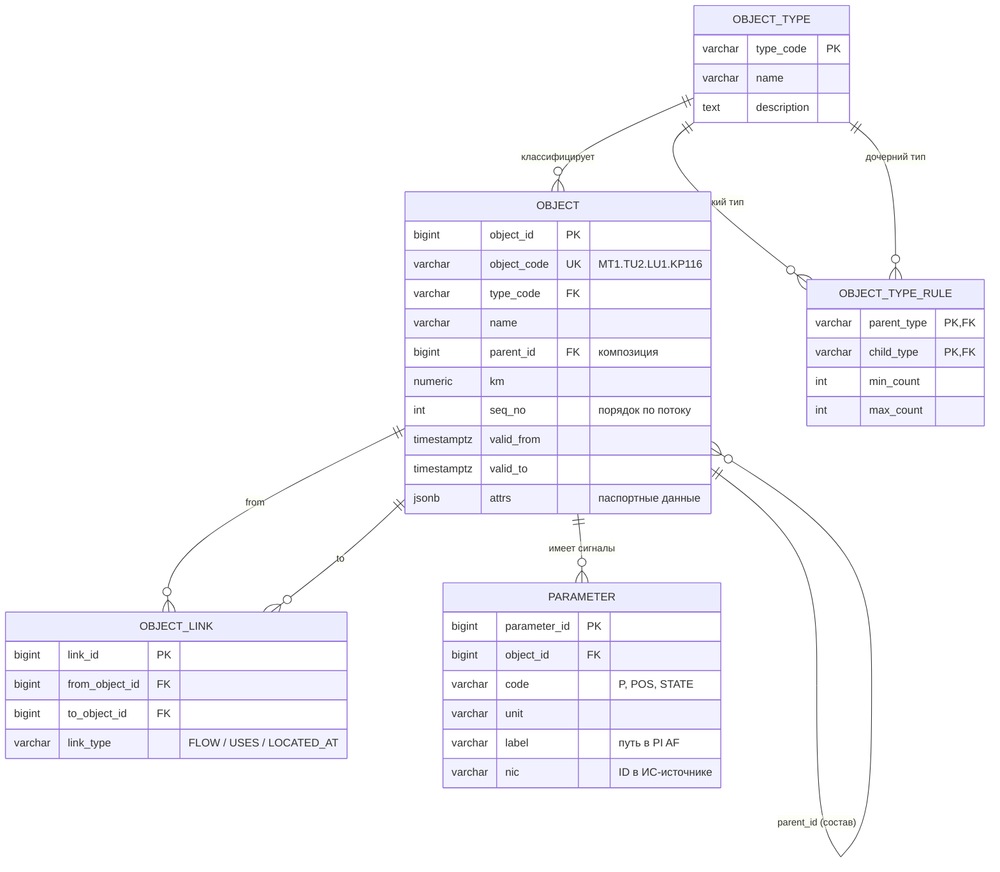
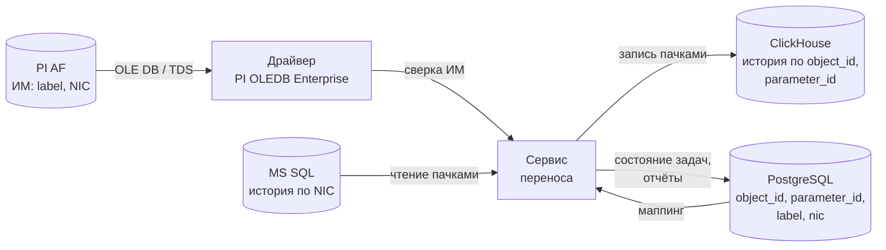
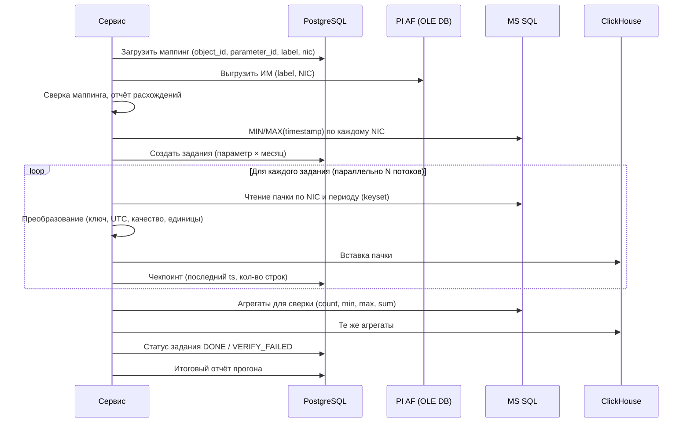

# Решение тестового задания (системный аналитик)

Состав решения:

| Файл | Что внутри |
|---|---|
| `Решение_тестового_задания.md` | Этот документ: разбор предметной области, решение заданий 1 и 2 |
| `task1/task1_schema.sql` | DDL для PostgreSQL + примеры запросов «родитель/потомок», «выше/ниже по потоку» |
| `task1/task1_section.json` | Полная модель выделенного на рис. 3 участка (2 ТУ, 428 объектов, 202 связи) |
| `task1/task1_data.sql` | Те же данные в виде INSERT для PostgreSQL |
| `task1/generate_model.py` | Скрипт, из которого получены JSON и INSERT (проверен на тестовой БД) |

---

## 0. Предметная область простыми словами

### Как устроен нефтепровод

Нефть по трубе сама не течёт — её толкают насосы, а на трение о стенки трубы теряется давление. Поэтому труба разбита на куски, и в начале каждого куска стоит насосная станция, которая снова поднимает давление.

```
 РП  ──► ГНПС ══КП══КП══КП══► НПС ══КП══КП══КП══► НПС ══КП══КП══► РП
 │       (старт)   линейная часть   (подкачка)                        │
 └──────────────────── технологический участок (ТУ) ───────────────────┘
          перекачка «из резервуара в резервуар»
```

| Термин | Что это на самом деле |
|---|---|
| **МН / МТ** — магистральный нефтепровод / трубопровод | Вся «труба» из точки А в точку Б (сотни-тысячи км) |
| **ТУ** — технологический участок | Кусок МН, который гидравлически работает как одно целое: от резервуарного парка до следующего резервуарного парка. Внутри ТУ давление «передаётся» от станции к станции, поэтому все НПС ТУ управляются согласованно (единым режимом) |
| **РП** — резервуарный парк | Группа больших резервуаров (РВС). «Буфер» между ТУ: позволяет ТУ работать независимо друг от друга |
| **ГНПС** — головная нефтеперекачивающая станция | Первая станция ТУ. Забирает нефть из РП. Кроме обычного состава НПС имеет **ПНС** (подпорную насосную) — магистральные насосы не могут сами «высосать» нефть из резервуара, нужен подпор |
| **НПС** — промежуточная НПС | Через 50–100 км, поднимает давление |
| **ЛЧ** — линейная часть | Сама труба между станциями |
| **КП** на ЛЧ | Через 10–30 км: линейная задвижка (позволяет отсечь кусок трубы при аварии) + датчики давления до и после неё. На практике это **контролируемый пункт телемеханики** — поэтому на мнемосхеме рис. 3 у КП ещё есть `U` (напряжение питания) и `U_СКЗ / I_СКЗ` (станция катодной защиты трубы от коррозии) |
| **КП** в конце ТУ | **Конечный пункт** (с РП). Внимание: в задании одна аббревиатура «КП» используется в двух смыслах — в модели я развёл их на разные типы (`KP` и `END`) |

### Что внутри промежуточной НПС (рис. 2)

Нефть проходит по станции так: **вход → КПП СОД (3) → ФГУ (4) → НС (1) → САРД (2) → КПП СОД (3) → выход**.

| № на рис. 2 | Узел | Зачем |
|---|---|---|
| 3 | **КПП СОД** — камера пуска-приёма средств очистки и диагностики | По трубе периодически гоняют «поршни»: скребки (чистят стенки) и внутритрубные дефектоскопы. Камера приёма их ловит, камера пуска — запускает дальше. Это и есть «вход/выход» станции |
| 4 | **ФГУ** — фильтры-грязеуловители | Защищают насосы от мусора (окалина, парафин, остатки после очистки). 2 параллельные нитки: одна работает, вторую можно чистить |
| 1 | **НС** — магистральная насосная | 4 **МНА** (магистральных насосных агрегата) **последовательно**: давление складывается. Обычно 3 в работе + 1 в резерве. У каждого — входная и выходная задвижка, а **обратный клапан (ОК / «КО» на схеме)** на обводе позволяет нефти пройти мимо остановленного насоса |
| 2 | **САРД** — система автоматического регулирования давления | 2 параллельные регулирующие заслонки. Прикрываясь, «дросселируют» поток, чтобы давление на выходе не превысило допустимое для трубы, а на входе не упало ниже допустимого для насосов |

### Мнемосхема (рис. 3) — это экран диспетчера

Это экран **СДКУ** (система диспетчерского контроля и управления). Внизу — обзорная схема, красной рамкой выделен наш участок. На нём читается следующее:

- **Два параллельных ТУ в одном коридоре**:
  - **ТУ-1** (верхняя линия): ГНПС-1 → КП 282…499 → **НПС-2** → КП 6…114 → РП;
  - **ТУ-2** (нижняя линия): ГНПС-2 → КП 15…166 → **НПС-2** → КП 214…416 → РП.
- **Общий РП** нарисован между ГНПС-1 и ГНПС-2 — это ровно та ситуация из условия: «для каждого ТУ своя НПС, но РП может быть общий».
- На ТУ-1 после НПС-2 **нумерация км начинается заново** (499 → 6). Значит, километр не может быть ключом для упорядочивания — нужен явный порядок или явные связи по потоку. Это важная находка для модели.
- Верхняя часть экрана — детализация фрагмента ТУ-2 (КП-99…КП-166, затемнён на обзорной схеме) и узел входа НПС-2 с камерами СОД (давление 0.3 — камеры пустые).

---

## Задание 1. Структура хранения информации

### 1.1. Ключевая проблема: одного дерева недостаточно

Наивный вариант «у каждого объекта есть `parent_id`» ломается в трёх местах:

1. **Общий РП.** Он входит в состав и ГНПС-1, и ГНПС-2. В дереве у объекта может быть только один родитель.
2. **Положение относительно соседей.** Задание просит определить положение объекта «относительно других». Родитель/потомок — это вертикаль (что из чего состоит). А «КП-387 находится перед НПС-2» — это горизонталь (порядок по ходу потока), и деревом она не описывается.
3. **Километраж не уникален и не монотонен** (см. 499 → 6 на ТУ-1; у ТУ-1 и ТУ-2 вообще разные шкалы км).

### 1.2. Решение: дерево состава + граф связей

Объекты описываются двумя независимыми структурами:

| Измерение | Чем хранится | Отвечает на вопрос |
|---|---|---|
| **Состав (композиция)** | `object.parent_id` — строгое дерево, ровно один родитель | «Кто родитель, кто дочерний?», «Из чего состоит НПС?» |
| **Технологические связи** | таблица `object_link` с типом связи | «Что выше/ниже по потоку?», «Кто пользуется общим РП?», «Где физически стоит?» |

Типы связей:

- `FLOW` — A → B по ходу потока нефти;
- `USES` — A использует разделяемый объект B, не являясь его владельцем (ГНПС-1 → общий РП, ГНПС-2 → общий РП);
- `LOCATED_AT` — A размещён на технологической площадке B (НПС-2 ТУ-1 и НПС-2 ТУ-2 стоят на одной площадке).

Куда «положить» общий РП в дереве? Вводится объект **«Технологическая площадка»** (на практике это ЛПДС — линейная производственно-диспетчерская станция, где стоят НПС нескольких ТУ и общий парк). РП входит в состав площадки, а ГНПС ссылаются на него связью `USES`. Так дерево остаётся деревом, а факт «РП общий» выражен явно.

> Это не изобретение: та же идея используется в PI AF (откуда в задании 2 переносятся данные) — там у элемента одна связь **Composition/Parent-Child** и сколько угодно **Weak reference**. Значит, модель без потерь ляжет на исходную структуру PI AF.

Дополнительно:

- **Справочник типов + правила композиции** (`object_type_rule`): какой тип может быть потомком какого и в каком количестве. Пример: НС = ровно 4 МНА, ПНС = от 1 до 10 ПА. Так модель сама не даёт ошибиться при наполнении: задвижку нельзя положить прямо в РП.
- **Параметры объектов** (`parameter`): сигналы, у которых есть временные ряды (давление, положение задвижки, состояние насоса). Поля `object_id, parameter_id, label, nic` — это ровно та «БД метаданных» из задания 2. Задания связаны: ИМ из задания 1 становится приёмником в задании 2.
- **Версионность** (`valid_from / valid_to`): оборудование меняют, КП переносят при реконструкции. Исторические данные (задание 2) должны ссылаться на тот состав, который был на момент измерения.

### 1.3. ER-диаграмма



DDL полностью — в `task1/task1_schema.sql`.

### 1.4. Дерево состава выделенного участка

```
МТ (выделенный участок)
├── Головная площадка (SITE)
│   └── Общий РП ◄─────────────── USES ── ГНПС-1, ГНПС-2
│       ├── РВС-1
│       └── РВС-2
├── Площадка НПС-2 (SITE) ◄────── LOCATED_AT ── НПС-2 (ТУ-1), НПС-2 (ТУ-2)
├── ТУ-1
│   ├── ГНПС-1
│   │   ├── ПНС ── ПА-1..ПА-3 (у каждого задвижки вход/выход)
│   │   ├── КПП СОД ── камера приёма, камера пуска, задвижки узла
│   │   ├── Блок ФГУ ── ФГУ-1, ФГУ-2 (у каждого задвижки вход/выход)
│   │   ├── НС ── МНА-1..МНА-4 (задвижка вход, задвижка выход, ОК)
│   │   └── САРД ── нитка 1, нитка 2 (задвижка, регулирующая заслонка, задвижка)
│   ├── ЛУ ГНПС-1 – НПС-2
│   │   ├── КП-282 ── ДД до, линейная задвижка, ДД после
│   │   ├── …  (КП-289 … КП-478)
│   │   └── КП-499
│   ├── НПС-2 (ТУ-1)      — тот же состав, что у ГНПС, но без ПНС
│   ├── ЛУ НПС-2 – КП     ── КП-6 … КП-114
│   └── Конечный пункт ТУ-1 ── РП ── РВС-1, РВС-2
└── ТУ-2
    ├── ГНПС-2            ── аналогично ГНПС-1
    ├── ЛУ ГНПС-2 – НПС-2 ── КП-15 … КП-166
    ├── НПС-2 (ТУ-2)
    ├── ЛУ НПС-2 – КП     ── КП-214 … КП-416
    └── Конечный пункт ТУ-2 ── РП ── РВС-1, РВС-2
```

Технологическая цепочка `FLOW` каждого ТУ: `Общий РП → ГНПС → КП … → НПС-2 → КП … → РП конечного пункта`. Внутри станций: `ПНС → ФГУ → НС → САРД → КПП СОД` (ГНПС) и `КПП СОД → ФГУ → НС → САРД` (НПС); внутри НС: `МНА-1 → МНА-2 → МНА-3 → МНА-4`; внутри КП: `ДД до → задвижка → ДД после`.

### 1.5. Фрагмент JSON

Полная модель — `task1/task1_section.json`. Фрагмент (один КП ТУ-2 и связи):

```json
{
  "tree": {
    "id": "MT1", "type": "MT", "name": "Магистральный трубопровод",
    "children": [
      { "id": "MT1.SITE_HEAD", "type": "SITE", "name": "Головная площадка (ГНПС-1, ГНПС-2)",
        "children": [
          { "id": "MT1.SITE_HEAD.RP", "type": "RP", "name": "Общий РП головной площадки",
            "children": [ { "id": "MT1.SITE_HEAD.RP.RVS1", "type": "RVS", "name": "РВС-1" } ] } ] },
      { "id": "MT1.TU2", "type": "TU", "name": "ТУ-2", "seq": 2,
        "children": [
          { "id": "MT1.TU2.LU1", "type": "LU", "name": "ЛУ ГНПС-2 – НПС-2", "seq": 2,
            "children": [
              { "id": "MT1.TU2.LU1.KP116", "type": "KP", "name": "КП-116", "km": 116, "seq": 10,
                "children": [
                  { "id": "MT1.TU2.LU1.KP116.DD_BEFORE", "type": "DD", "name": "Датчик давления до задвижки",
                    "parameters": [ { "code": "P", "name": "Давление", "unit": "кгс/см2" } ] },
                  { "id": "MT1.TU2.LU1.KP116.ZD", "type": "ZD", "name": "Линейная задвижка",
                    "parameters": [ { "code": "POS", "unit": "%" }, { "code": "STATE", "unit": "enum" } ] },
                  { "id": "MT1.TU2.LU1.KP116.DD_AFTER", "type": "DD", "name": "Датчик давления после задвижки" }
                ] } ] } ] } ]
  },
  "links": [
    { "from": "MT1.TU1.GNPS1",      "to": "MT1.SITE_HEAD.RP", "type": "USES" },
    { "from": "MT1.TU2.GNPS2",      "to": "MT1.SITE_HEAD.RP", "type": "USES" },
    { "from": "MT1.TU2.NPS2",       "to": "MT1.SITE_NPS2",    "type": "LOCATED_AT" },
    { "from": "MT1.TU2.LU1.KP102",  "to": "MT1.TU2.LU1.KP116", "type": "FLOW" },
    { "from": "MT1.TU2.LU1.KP116",  "to": "MT1.TU2.LU1.KP137", "type": "FLOW" }
  ]
}
```

### 1.6. Как по модели определить положение объекта (проверено на тестовой БД)

| Вопрос | Как отвечаем | Результат на данных |
|---|---|---|
| Кто родители датчика `ДД до` на КП-116? | рекурсивный подъём по `parent_id` | ДД → КП-116 → ЛУ ГНПС-2–НПС-2 → ТУ-2 → МТ |
| Из чего состоит ТУ-2? | рекурсивный спуск по `parent_id` | 215 объектов |
| Кто пользуется общим РП? | `object_link` с типом `USES` | ГНПС-1, ГНПС-2 |
| Что ниже по потоку от КП-387 (ТУ-1)? | рекурсивный обход `FLOW` | КП-390 … КП-499 → НПС-2 → КП-6 … КП-114 → РП |

SQL этих запросов — в конце `task1/task1_schema.sql`.

### 1.7. Допущения (их стоит проговорить на собеседовании)

- Количество задвижек в узле КПП СОД, число ПА на ГНПС и РВС в парках взяты условно — в реальности берутся из технологической схемы/паспорта объекта.
- Подключение стороннего трубопровода к ТУ-1 в районе 390 км (видно на рис. 3) — за рамками выделенного участка; в модели оно описывается связью `FLOW` от объекта другого МН к КП ТУ-1 (узел подключения).
- Модель расширяется без изменения структуры: СКЗ, датчики температуры, узлы учёта нефти (СИКН), камеры отбора — это новые типы в справочнике и новые строки в правилах композиции.

---

## Задание 2. Техническое задание на сервис переноса данных временных рядов

### Что происходит на самом деле

Сейчас данные хранятся так:

- **PI AF** (Asset Framework, продукт OSIsoft/AVEVA) — **информационная модель**: дерево «ТУ → НПС → МНА → атрибут "Давление на выходе"». У каждого атрибута есть `label` (человекочитаемое имя/путь) и `NIC` (идентификатор сигнала, по которому лежат его значения).
- **MS SQL** — сами **значения** во времени, ключ — `NIC`: «сигнал NIC-123 в 10:00:00 был 24.2».

Нужно переехать на импортонезависимый стек:

- **PostgreSQL** — новая ИМ (та самая модель из задания 1). У каждого параметра есть `object_id, parameter_id` и, для сопоставления со старой системой, `label, nic`;
- **ClickHouse** — колоночная СУБД, хорошо подходит для миллиардов строк временных рядов. Значения хранятся с ключом `(object_id, parameter_id)`.

Задача сервиса — взять **всю историю** из MS SQL и переложить в ClickHouse, **переписав ключ** со старого (`NIC`) на новый (`object_id, parameter_id`). Связку между ними даёт PostgreSQL, а PI AF используется для сверки, что сопоставление верное.



---

### ТЕХНИЧЕСКОЕ ЗАДАНИЕ
**на разработку сервиса переноса исторических данных временных рядов в ЕХД**

#### 1. Общие сведения

| | |
|---|---|
| Наименование | Сервис переноса исторических данных временных рядов (далее — Сервис) |
| Основание | Работы по созданию единого хранилища данных (ЕХД) |
| Тип | Серверное приложение (Java 17+ или Python 3.11+), запуск в контейнере (Docker / Kubernetes) |
| Режим работы | Пакетный: однократный полный перенос + инкрементальная досинхронизация до момента переключения потребителей |

#### 2. Назначение и цели

Сервис предназначен для полного переноса накопленных временных рядов из исходного хранилища (ИМ — PI AF, данные — MS SQL) в целевое хранилище ЕХД (ИМ — PostgreSQL, данные — ClickHouse).

Цели:
1. Перенести 100 % исторических данных сопоставленных параметров за весь период без потерь и искажений.
2. Перевести идентификацию рядов с `NIC` источника на `(object_id, parameter_id)` целевой ИМ.
3. Обеспечить проверяемость: по итогам каждого прогона формировать отчёт о сверке источника и приёмника.
4. Не влиять на работу производственных систем-источников.

#### 3. Характеристика источников и приёмников

| Система | Роль | Доступ | Данные |
|---|---|---|---|
| PI AF | Источник ИМ (для сверки) | PI OLEDB Enterprise (драйвер OLE DB), только чтение | Элементы, атрибуты: `label`, `NIC` |
| MS SQL | Источник временных рядов | TDS (ODBC/JDBC), только чтение, желательно реплика | `NIC, timestamp, value, quality` |
| PostgreSQL | Целевая ИМ + служебные таблицы Сервиса | SQL; чтение ИМ, запись служебных таблиц | `object_id, parameter_id, label, nic` |
| ClickHouse | Приёмник временных рядов | HTTP/Native; запись | `object_id, parameter_id, ts, value, quality` |

> **Уточнить у заказчика (блокирующие вопросы):** точная структура таблиц истории в MS SQL (узкая «NIC-время-значение» или широкая), тип хранения времени (локальное/UTC), формат и справочник кодов качества, общий объём (кол-во NIC, глубина истории, частота записи), наличие реплики MS SQL для чтения.

#### 4. Функциональные требования

**ФТ-1. Загрузка маппинга.** Сервис читает из PostgreSQL перечень параметров целевой ИМ: `object_id, parameter_id, label, nic, data_type, unit`. Перечень можно ограничить фильтром (по ТУ, по типу объекта, по списку `parameter_id`) для пилотного переноса.

**ФТ-2. Сверка с исходной ИМ (PI AF).** Перед переносом Сервис выгружает из PI AF пары `label ↔ NIC` и сравнивает с маппингом из PostgreSQL. Результат — отчёт расхождений:
- параметр есть в PG, но `label` не найден в PI AF;
- `label` найден, но `NIC` в PI AF отличается от `nic` в PG;
- атрибут PI AF ссылается на `NIC`, которого нет в PG (непокрытый сигнал);
- один `NIC` сопоставлен нескольким `parameter_id` (дубль).

Параметры с расхождениями в перенос не берутся (статус `MAPPING_ERROR`) до исправления маппинга. Порог допустимых расхождений настраивается.

**ФТ-3. Формирование заданий.** Работа режется на задания `(parameter_id, nic, period_from, period_to)`; период по умолчанию — 1 месяц. Границы истории для каждого NIC Сервис определяет запросом `MIN/MAX(timestamp)`. Задания и их статусы хранятся в PostgreSQL (п. 7), что даёт возобновление после сбоя.

**ФТ-4. Извлечение из MS SQL.** Чтение пачками с keyset-пагинацией по `(nic, timestamp)` (не через `OFFSET`), размер пачки настраивается (по умолчанию 100 000 строк). Требуется индекс по `(nic, timestamp)` на стороне источника. Чтение — в режиме snapshot isolation или с реплики, без блокировок производственных таблиц.

**ФТ-5. Преобразование.**
| Что | Правило |
|---|---|
| Ключ | `NIC` → `(object_id, parameter_id)` по маппингу |
| Время | Приведение к UTC, хранение `DateTime64(3, 'UTC')`. Если в источнике локальное время — пересчёт **с учётом исторических смен часовых поясов РФ** (летнее время до 2011 г., UTC+4 для Москвы в 2011–2014 гг.) по базе tz, а не фиксированным смещением |
| Значение | Числовые → `Float64`; дискретные (состояние задвижки, насоса) → целочисленный код + справочник состояний в PG; строковые → отдельное поле |
| Качество | Коды качества источника (в т.ч. системные состояния PI: `Bad Input`, `I/O Timeout`, `Shutdown` и т.п.) маппятся на единый справочник качества ЕХД. Значения с плохим качеством **переносятся** с соответствующим флагом, а не отбрасываются |
| Единицы | Если единица в целевой ИМ отличается от источника (напр. кгс/см² → МПа) — пересчёт по справочнику; исходное значение не теряется (сохраняется в журнале правил) |
| Аномалии | NaN/NULL, дубли по `(nic, timestamp)`, значения вне физического диапазона — **не чистятся**, переносятся как есть с флагом; ведётся статистика. Перенос не должен «улучшать» историю — это задача отдельного контура качества данных |

**ФТ-6. Запись в ClickHouse.** Вставка крупными пачками (не менее 10 000 строк, рекомендуется ≥100 000) — мелкие вставки в ClickHouse приводят к ошибке «too many parts». Предлагаемая таблица:

```sql
CREATE TABLE ts_history
(
    object_id     UInt64,
    parameter_id  UInt64,
    ts            DateTime64(3, 'UTC'),
    value         Float64,
    value_str     Nullable(String),
    quality       UInt16,
    source        LowCardinality(String),   -- 'MSSQL_LEGACY'
    load_id       UInt64,                   -- ID прогона для трассируемости
    inserted_at   DateTime DEFAULT now()
)
ENGINE = ReplacingMergeTree(inserted_at)
PARTITION BY toYYYYMM(ts)
ORDER BY (parameter_id, ts);
```

`ReplacingMergeTree` с ключом `(parameter_id, ts)` обеспечивает **идемпотентность**: повторная загрузка того же периода после сбоя не создаёт дублей (дубли схлопываются при слиянии; для сверки используется `FINAL` или `uniqExact`).

**ФТ-7. Режимы запуска.**
- `full` — полный перенос всей истории;
- `incremental` — перенос данных с отметки последнего успешного прогона (watermark) до текущего момента; используется до переключения потребителей на ЕХД, чтобы не было «дыры» между переносом и началом штатной записи;
- `reload` — перезагрузка заданного периода/параметров (после исправления маппинга);
- `verify` — только сверка, без переноса.

**ФТ-8. Сверка результата.** По каждому заданию (параметр × месяц) сравниваются источник и приёмник:
- количество записей;
- `MIN/MAX` времени;
- `SUM` и `AVG` значений (с допуском на погрешность float), количество записей по кодам качества.

Задание считается успешным, только если сверка прошла. По итогам формируется отчёт (CSV/HTML + записи в PG): сколько параметров перенесено полностью, с расхождениями, не перенесено и почему.

**ФТ-9. Управление и мониторинг.** Запуск/останов/пауза через CLI или REST API; прогресс (% заданий, строк/с, ETA) — в лог и в метрики (Prometheus); возобновление с места остановки без повторной обработки завершённых заданий.

#### 5. Алгоритм работы



#### 6. Нефункциональные требования

| Категория | Требование |
|---|---|
| Производительность | Не менее 300 000 строк/с на запись (уточняется по результатам пилота). Оценка объёма: 50 000 сигналов × 1 знач./мин × 5 лет ≈ 1,3·10¹¹ строк → при 300 тыс./с ≈ 5 суток. Параллелизм настраивается |
| Нагрузка на источник | Ограничение числа одновременных соединений и скорости чтения из MS SQL (настройки `max_connections`, `rows_per_sec`); возможность работы только в заданном окне (например, ночью). Источник — производственная система, её работа приоритетнее переноса |
| Надёжность | При сбое (обрыв сети, падение СУБД) — повтор с экспоненциальной задержкой (до N попыток), затем задание в статус `FAILED` без остановки остальных. Перезапуск Сервиса продолжает работу с последнего чекпоинта |
| Целостность | Идемпотентность записи (ФТ-6); отсутствие потерь подтверждается сверкой (ФТ-8) |
| Безопасность | Учётные записи только с минимально необходимыми правами (источники — только чтение). Секреты — в хранилище секретов, не в конфиге и не в логах. Работа в контуре предприятия с учётом требований к объектам КИИ (187-ФЗ) и регламентов сегментации сети АСУ ТП / корпоративной сети |
| Логирование | Структурированные логи (JSON): прогон, задание, параметр, период, кол-во строк, длительность, ошибки. Журнал аудита запусков |
| Конфигурирование | Файл конфигурации (YAML) + переменные окружения: подключения, размер пачки и периода, параллелизм, фильтры параметров, пороги сверки |
| Сопровождение | Код в Git, unit- и интеграционные тесты (testcontainers для PG/CH/MS SQL), README и инструкция администратора |

#### 7. Служебные таблицы Сервиса (PostgreSQL)

```sql
CREATE TABLE mig_run (
    run_id        bigserial PRIMARY KEY,
    mode          varchar(20) NOT NULL,          -- full / incremental / reload / verify
    started_at    timestamptz NOT NULL DEFAULT now(),
    finished_at   timestamptz,
    status        varchar(20) NOT NULL,          -- RUNNING / DONE / FAILED / STOPPED
    config        jsonb                          -- снимок параметров запуска
);

CREATE TABLE mig_task (
    task_id       bigserial PRIMARY KEY,
    run_id        bigint REFERENCES mig_run,
    parameter_id  bigint NOT NULL,
    nic           varchar(100) NOT NULL,
    period_from   timestamptz NOT NULL,
    period_to     timestamptz NOT NULL,
    status        varchar(20) NOT NULL,          -- NEW / IN_PROGRESS / LOADED / DONE /
                                                 -- VERIFY_FAILED / FAILED / MAPPING_ERROR
    last_ts       timestamptz,                   -- чекпоинт
    rows_read     bigint DEFAULT 0,
    rows_written  bigint DEFAULT 0,
    src_checksum  jsonb,                         -- count/min/max/sum источника
    dst_checksum  jsonb,                         -- то же для приёмника
    attempts      int DEFAULT 0,
    error_text    text,
    updated_at    timestamptz DEFAULT now(),
    UNIQUE (parameter_id, period_from, period_to, run_id)
);

CREATE TABLE mig_mapping_issue (
    run_id        bigint REFERENCES mig_run,
    parameter_id  bigint,
    label         varchar(300),
    nic_pg        varchar(100),
    nic_af        varchar(100),
    issue_type    varchar(30)                    -- LABEL_NOT_FOUND / NIC_MISMATCH / NOT_MAPPED / DUPLICATE
);
```

#### 8. Порядок контроля и приёмки

| № | Проверка | Критерий успеха |
|---|---|---|
| 1 | Пилот на одном ТУ (~1–5 % параметров) | Сверка 100 % заданий без расхождений; измерена фактическая скорость, по ней уточнён план полного переноса |
| 2 | Сверка маппинга | Отчёт расхождений сформирован; все расхождения устранены или согласованы с заказчиком |
| 3 | Полнота | Для каждого перенесённого параметра совпадают `count`, `min/max(ts)` по каждому месяцу |
| 4 | Точность | Совпадают `sum/avg` (допуск ≤ 1e-9 относительный); выборочная проверка 1 000 случайных точек «значение в значение» |
| 5 | Отказоустойчивость | Принудительная остановка Сервиса посреди прогона → после перезапуска нет ни потерь, ни дублей |
| 6 | Нагрузка на источник | Во время переноса показатели MS SQL (CPU, IO, время отклика производственных запросов) в согласованных пределах |
| 7 | Бизнес-проверка | Технолог сравнивает тренды 3–5 ключевых параметров (давление на выходе НПС, расход) в старой и новой системе визуализации — графики идентичны |

#### 9. Риски и допущения

- **Время.** Самый частый источник тихих ошибок при переносе истории — часовые пояса и переходы на летнее время: возможны «дыры» и «дубли» в один час. Обязательно проверять на данных до 2014 года.
- **Изменения маппинга во времени.** Если за историю сигнал переназначался (датчик заменили, NIC сменился), одному `parameter_id` может соответствовать несколько NIC в разные периоды. Требуется маппинг с периодом действия — уточнить у заказчика.
- **Сжатие данных в источнике.** Если история в MS SQL прорежена (хранятся только изменения — exception/compression, как принято в PI), Сервис переносит её как есть, не «достраивая» точки. Потребители ЕХД должны знать, что ряд неравномерный.
- **Объём.** Оценка в п. 6 условна — требуется фактический замер на пилоте.

---

## Что сказать на собеседовании (коротко)

1. **Задание 1:** «Одного `parent_id` недостаточно: общий РП ломает дерево, а положение по трассе — это не иерархия. Поэтому дерево состава плюс типизированный граф связей. Это совпадает с подходом PI AF (composition + weak reference), значит модель переносится из PI AF без потерь. И километраж — не ключ: на мнемосхеме нумерация начинается заново после НПС-2».
2. **Задание 2:** «Главное — не скорость, а доказуемая полнота: идемпотентная запись, чекпоинты, сверка count/min/max/sum по каждому параметру за каждый месяц. И не навредить источнику — это производственная система».
3. **Связь заданий:** таблица `parameter` из задания 1 и есть «БД метаданных» `object_id, parameter_id, label, nic` из задания 2.
